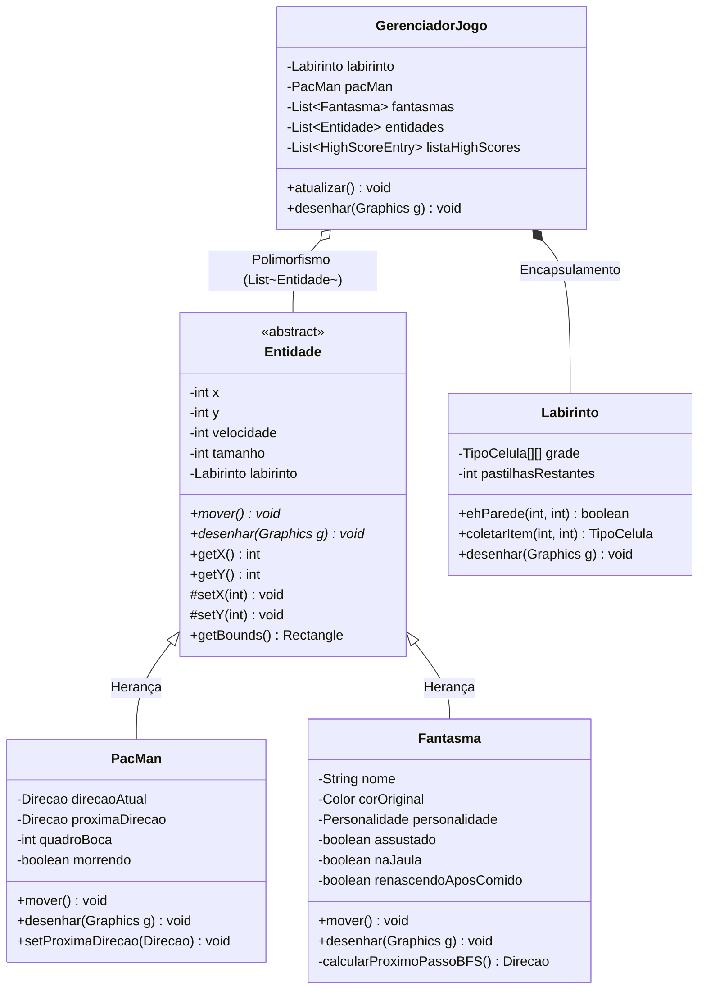

# Pac-Man Arcade 2D em Java

Projeto acadêmico desenvolvido em Java nativo com foco na aplicação prática, estruturada e aprofundada dos **quatro pilares da Programação Orientada a Objetos (POO)**: **Abstração**, **Herança**, **Polimorfismo** e **Encapsulamento**.

O jogo recria a experiência clássica do arcade Pac-Man utilizando exclusivamente as bibliotecas gráficas padrão da plataforma (`Java Swing` e `AWT`), incluindo inteligência artificial para os quatro fantasmas (BFS), síntese nativa de áudio procedural em tempo real, renderização autêntica em pixel-art, placar dinâmico com persistência de dados (Top 5 High Scores) e textos flutuantes de pontuação.

---

## 🏛️ Os 4 Pilares da POO no Projeto

A arquitetura do jogo foi concebida para que cada um dos quatro pilares desempenhe um papel central no design, manutenibilidade e extensibilidade do código.



---

### 1. Abstração

A **Abstração** consiste em isolar os detalhes essenciais de uma entidade ou conceito, omitindo particularidades irrelevantes para o contexto geral e estabelecendo contratos bem definidos.

#### Aplicação no Projeto:
1. **Classe Abstrata `Entidade` (`jogo.entidades.Entidade`)**:
   - Modela qualquer elemento dinâmico móvel no labirinto.
   - Centraliza o controle de coordenadas na tela (`x`, `y`), dimensões (`tamanho`), velocidade, alinhamento com a grade do labirinto (`isAlinhadoNaGrade`), caixa de colisão (`getBounds()`) e cálculo de linha/coluna central.
   - Define dois métodos puramente abstratos que estabelecem o contrato operacional obrigatório para qualquer personagem do jogo:
     ```java
     public abstract void mover();
     public abstract void desenhar(Graphics g);
     ```
   - O `GerenciadorJogo` manipula as entidades conhecendo apenas essa abstração, sem precisar saber se a entidade é controlada por teclado ou por inteligência artificial.

2. **Tipos Abstratos de Dados (Enums `Direcao` e `TipoCelula`)**:
   - `Direcao`: Abstrai os vetores de movimento (`dx`, `dy`) e o ângulo de rotação da boca (`anguloBase`), eliminando números mágicos e cálculos manuais de trigonometria espalhados pelo código.
   - `TipoCelula`: Abstrai o significado físico e as regras de pontuação de cada ladrilho da grade (`PAREDE`, `VAZIO`, `PASTILHA`, `POWER_UP`, `PORTA_CASA_FANTASMAS`), associando cada célula a seus respectivos pontos (`getPontos()`).

---

### 2. Herança

A **Herança** promove o reuso de código e a extensão de funcionalidades, permitindo que classes filhas (subclasses) herdem atributos e métodos de uma classe ancestral (superclasse), especializando seus comportamentos.

#### Aplicação no Projeto:
A superclasse `Entidade` serve como base direta para duas especializações concretas:

1. **`PacMan extends Entidade` (`jogo.entidades.PacMan`)**:
   - **Reaproveitamento**: Herda toda a física de movimentação contínua, bounding box de colisão e referência ao `Labirinto`.
   - **Especialização**:
     - Introduz controle de entrada do jogador com suporte a buffer de comando (`proximaDirecao`), permitindo viradas suaves nas esquinas antes do alinhamento completo.
     - Adiciona animação procedural de abertura e fechamento da boca (sprites matriciais 14x14).
     - Gerencia estados específicos de ciclo de vida, como a animação de morte com dissipação circular.

2. **`Fantasma extends Entidade` (`jogo.entidades.Fantasma`)**:
   - **Reaproveitamento**: Utiliza os mesmos mecanismos de posicionamento, velocidade e colisão com paredes herdados de `Entidade`.
   - **Especialização**:
     - Agrega quatro personalidades distintas (`Personalidade.PERSEGUIDOR`, `PATRULHEIRO`, `EMBOSCADOR`, `ESTRATEGISTA`) com alvos customizados.
     - Implementa o algoritmo de **Busca em Largura (BFS)** para navegação inteligente e desvio de obstáculos na grade.
     - Implementa a máquina de estados dos fantasmas: **Perseguição**, **Dispersão**, **Assustado** (modo vulnerável acionado pela super-pastilha), **Comido/Olhos** (retorno célere à jaula) e rotina de **Renascimento Temporizado** com liberação gradual.

---

### 3. Polimorfismo

O **Polimorfismo** permite que objetos de diferentes classes derivadas de uma mesma hierarquia respondam a uma mesma mensagem ou chamada de método de maneiras distintas, decididas dinamicamente em tempo de execução (*Dynamic Method Dispatch*).

#### Aplicação no Projeto:

1. **Polimorfismo de Inclusão e Despacho Dinâmico (`List<Entidade>`)**:
   - No `GerenciadorJogo`, tanto a instância de `PacMan` quanto as quatro instâncias de `Fantasma` são armazenadas em uma lista polimórfica comum:
     ```java
     private final List<Entidade> entidades;
     // Inicialização:
     this.entidades = new ArrayList<>();
     this.entidades.add(pacMan);
     this.entidades.addAll(fantasmas);
     ```
   - Durante o **Game Loop** (`atualizar()`), o motor do jogo executa a movimentação de todas as entidades de forma completamente polimórfica:
     ```java
     for (Entidade entidade : entidades) {
         entidade.mover(); // Chamada polimórfica!
     }
     ```
     *Em tempo de execução, a JVM resolve dinamicamente qual implementação de `mover()` invocar:*
     - Para o `PacMan`: processa o comando do teclado, alinha à grade e atualiza a rotação do sprite.
     - Para o `Fantasma`: executa a IA de rastreamento de nós, decide bifurcações e transita entre os modos de fuga/caça.

2. **Polimorfismo na Renderização Gráfica (`desenhar`)**:
   - O método de pintura delega o desenho à lista genérica:
     ```java
     for (Entidade entidade : entidades) {
         entidade.desenhar(g); // Chamada polimórfica!
     }
     ```
     Cada entidade desenha a si mesma com sua própria representação gráfica (o Pac-Man desenha sua boca animada em amarelo, e os fantasmas desenham seus corpos ondulados em pixel-art com suas respectivas cores ou em azul quando vulneráveis).

3. **Sobrescrita de Métodos (`@Override`)**:
   - Implementação obrigatória e especializada de `mover()` e `desenhar(Graphics g)` em `PacMan` e `Fantasma`.
   - Na classe `HighScoreEntry`, sobrescreve o método `compareTo(HighScoreEntry outro)` da interface `Comparable<HighScoreEntry>` para permitir a ordenação decrescente natural de recordes na tabela de pontuações:
     ```java
     @Override
     public int compareTo(HighScoreEntry outro) {
         return Integer.compare(outro.pontuacao, this.pontuacao);
     }
     ```
   - Em `TelaJogo`, o método `paintComponent(Graphics g)` da biblioteca Swing (`JPanel`) é sobrescrito para acoplar a renderização customizada do jogo ao pipeline de renderização nativo do sistema operacional.

---

### 4. Encapsulamento

O **Encapsulamento** visa proteger o estado interno dos objetos contra acessos indevidos e modificações diretas descontroladas, garantindo que o estado de um componente só possa ser alterado por meio de interfaces públicas e regras bem definidas (*Information Hiding*).

#### Aplicação no Projeto:

1. **Visibilidade Restrita e Modificadores de Acesso**:
   - Todos os atributos de estado em `Entidade`, `PacMan`, `Fantasma`, `Labirinto` e `GerenciadorJogo` são declarados como `private` ou `protected`.
   - Modificadores `protected` em `Entidade` (como `setX()`, `setY()`, `setVelocidade()`) permitem que apenas as subclasses diretas (`PacMan`, `Fantasma`) alterem as variáveis internas durante seus cálculos de movimento, mantendo-as inacessíveis para o restante da aplicação.

2. **Encapsulamento da Matriz do Labirinto (`Labirinto.java`)**:
   - A matriz de células `TipoCelula[][] grade` é puramente privada.
   - Nenhuma classe externa tem acesso direto de escrita ou leitura na matriz. Toda interação é intermediada por métodos de negócio que aplicam validações rígidas:
     - `ehParede(linha, coluna)`: Trata limites do mapa, curvas e o túnel lateral com teletransporte (linha 10).
     - `coletarItem(linha, coluna)`: Verifica a existência de pastilha/power-up, atualiza a célula para `VAZIO`, decrementa o contador de pastilhas e retorna o tipo coletado para processamento de pontuação.

3. **Encapsulamento e Cópia Defensiva da Tabela de Recordes (`GerenciadorJogo.java`)**:
   - A lista `listaHighScores` é privada e serializada em arquivo binário (`highscores.dat`).
   - O método de consulta protege a integridade dos dados retornando uma coleção imutável:
     ```java
     public List<HighScoreEntry> getListaHighScores() {
         return Collections.unmodifiableList(listaHighScores);
     }
     ```
     Isso impede que componentes externos (como a tela de interface `TelaJogo`) adicionem, removam ou reordenem os recordes sem passar pela validação de negócio de `registrarJogador()`.
   - Todas as regras do Top 5 (manutenção de até 5 colocações, substituição por pontuação superior ou empate na 5ª posição e reset) ficam totalmente encapsuladas na lógica interna do gerenciador.

---

## 🎮 Funcionalidades do Jogo

- **Mecânica Clássica de Arcade**:
  - Labirinto autêntico com túnel de teletransporte lateral contínuo.
  - Coleta de pastilhas normais (10 pts) e super pastilhas (50 pts).
  - Modo assustado com fantasmas piscando em azul e pontuações exponenciais ao serem comidos (**+200, +400, +800, +1600 pts**).
  - Textos flutuantes exibindo os pontos ganhos exatamente onde o fantasma foi capturado.
- **Inteligência Artificial Autêntica dos 4 Fantasmas**:
  - **Blinky (Vermelho)**: Perseguidor agressivo mirando diretamente no Pac-Man.
  - **Pinky (Rosa)**: Emboscador mirando quatro células à frente da direção do jogador.
  - **Inky (Azul)**: Estrategista com cálculo vetorial cruzado entre Blinky e Pac-Man.
  - **Clyde (Amarelo)**: Patrulheiro que persegue à distância e dispersa para seu canto quando muito próximo.
  - Rotina de jaula com liberação escalonada no início da partida e retorno em modo "apenas olhos" após serem devorados, renascendo após 3 segundos.
- **Sistema de Recordes (Top 5 High Scores)**:
  - Tela inicial com campo para inserção do nome do jogador.
  - O jogo só começa após a digitação do nome e clique em "Iniciar Jogo".
  - Ranking dinâmico persistido em arquivo (`highscores.dat`).
  - Suporta até 5 colocações (inclusive pontuações zero), substituindo a menor pontuação quando o limite é excedido ou em caso de empate.
  - Botão na interface para **Resetar Ranking** a qualquer momento.
- **Áudio Sintetizado Nativo**:
  - Efeitos sonoros gerados dinamicamente via `javax.sound.sampled` (waka-waka, sirene contínua, alerta de modo assustado, som de fantasma devorado, morte e vitória), dispensando arquivos externos de áudio `.wav` ou `.mp3`.

---

## 📁 Estrutura de Pacotes e Classes

```text
src/
└── jogo/
    ├── Main.java                          # Ponto de entrada da aplicação
    ├── audio/
    │   └── GerenciadorSom.java            # Síntese e reprodução de áudio procedural
    ├── core/
    │   ├── GerenciadorJogo.java           # Orquestrador do estado, colisões e ciclo de jogo
    │   └── HighScoreEntry.java            # Modelo e comparador de pontuações do ranking
    ├── entidades/
    │   ├── Direcao.java                   # Enum de vetores e rotações de movimento
    │   ├── Entidade.java                  # Classe abstrata base (Abstração / Encapsulamento)
    │   ├── Fantasma.java                  # Subclasse dos fantasmas e IA BFS (Herança / Polimorfismo)
    │   └── PacMan.java                    # Subclasse do jogador e animações (Herança / Polimorfismo)
    ├── mapa/
    │   ├── Labirinto.java                 # Encapsulamento da matriz do mapa e renderização
    │   └── TipoCelula.java                # Enum dos tipos e pontuações de células da grade
    └── ui/
        ├── TelaJogo.java                  # Painel gráfico Swing, HUD, menus e inputs
        └── TextoPontuacaoFlutuante.java   # Efeito visual de pontuação ao devorar fantasmas
```

---

## 🚀 Como Compilar e Executar

### Pré-requisitos
- **Java Development Kit (JDK) 17** ou superior instalado e configurado no PATH.

### 1. Compilar o Projeto
Abra o terminal na raiz do projeto (`pacman_java`) e execute:

```bash
# Criar diretório de saída dos binários
mkdir bin

# Compilar todos os arquivos fonte Java
javac -encoding UTF-8 -d bin src/jogo/*.java src/jogo/*/*.java
```

### 2. Executar o Jogo
Com os binários compilados na pasta `bin`, execute:

```bash
java -cp bin jogo.Main
```

---

## 🕹️ Controles do Jogo

| Tecla / Ação | Função |
| :--- | :--- |
| **Setas Direcionais** ou **W, A, S, D** | Movimentar o Pac-Man (Cima, Baixo, Esquerda, Direita) |
| **R** | Reiniciar a partida atual |
| **P** | Pausar / Continuar o jogo |
| **Botão Iniciar Jogo** | Confirma o nome do jogador e inicia a partida |
| **Botão Resetar Ranking** | Zera a tabela de recordes persistida |

---

## 👥 Equipe de Desenvolvimento

- **Gustavo Henrique Gouveia Gomes**
- **Nicolle Carolina da Rocha**
